Enlace del video: https://youtu.be/K7sv36a3oyM

El propósito de este laboratorio es comprobar como el servicio RADIUS puede centralizar la autenticación, autorización y logs de los equipos de red con RADIUS (NPS y Active Directory), para que cada administrador entre con su propio usuario y solo tenga los permisos de su nivel.

## Versiones de los dispositivos

| Dispositivo | Imagen / Versión | Rol |
|-------------|------------------|-----|
| Router | Cisco IOL (versión: 15.7) | Cliente RADIUS, SSH |
| Switch | Cisco vIOS-L2 `viosl2-adventerprisek9-m.ssa.high_iron_20200929` (versión: 15.2) | Cliente RADIUS, SSH |
| Servidor | Windows Server 2022 (Standard, Desktop Experience) | Active Directory y NPS |
| PNetLab | versión: 4.2.10 | Plataforma de simulación |

## Direccionamiento VLSM - Infraestructura 3 (AAA con RADIUS)

Matricula: 2025-1410

Red base: `14.10.0.0/16` (últimos 4 dígitos de la matrícula)

| # | Segmento | Red | Máscara | Prefijo | Hosts | Rango útil | Broadcast |
|---|----------|-----|---------|---------|-------|------------|-----------|
| 1 | Gestión | 14.10.10.0 | 255.255.255.240 | /28 | 14 | 14.10.10.1 - 14.10.10.14 | 14.10.10.15 |

### Asignación de IPs

| Dispositivo | Interfaz | IP | Gateway |
|-------------|----------|----|---------|
| Servidor (AD + NPS) | Ethernet | 14.10.10.2/28 | 14.10.10.3 |
| Router (R1) | e0/0 | 14.10.10.3/28 | - |
| Switch (SW1) | Vlan1 | 14.10.10.4/28 | 14.10.10.3 |

---

## Topología

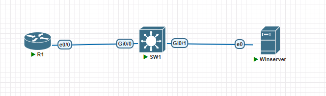

---

## Active Directory

### Usuarios y grupos

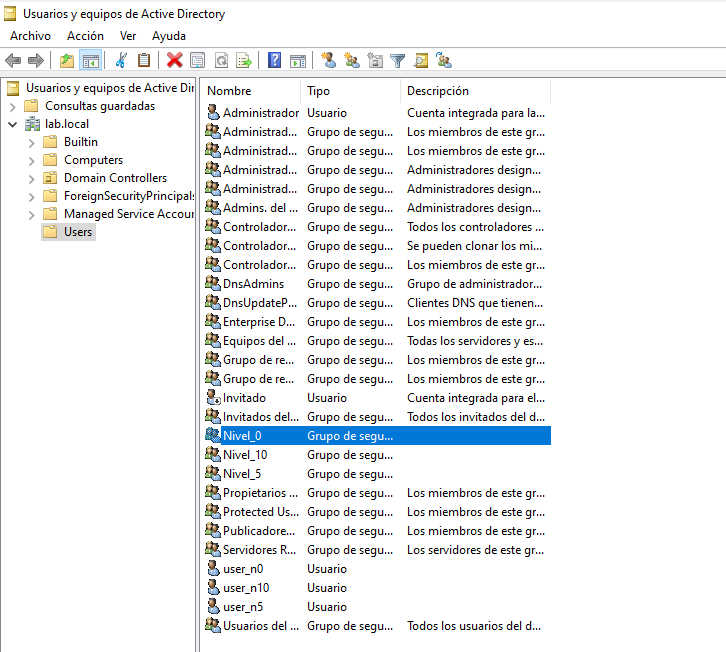

### Miembros de cada grupo

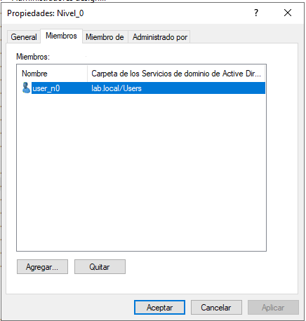

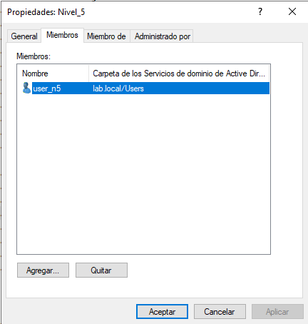

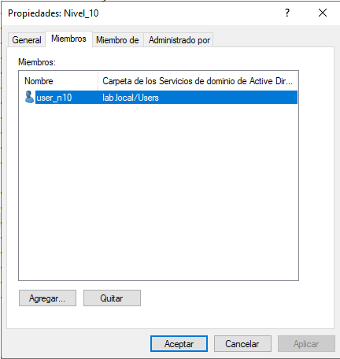

---

## NPS

### Clientes RADIUS

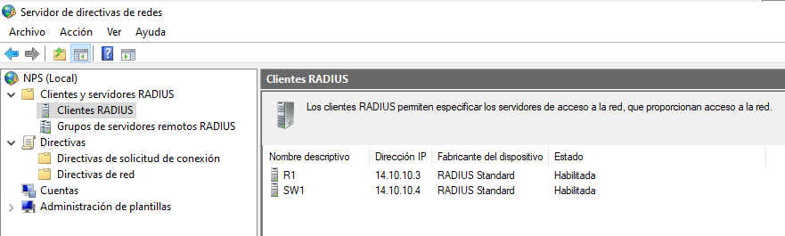

### Directivas de red

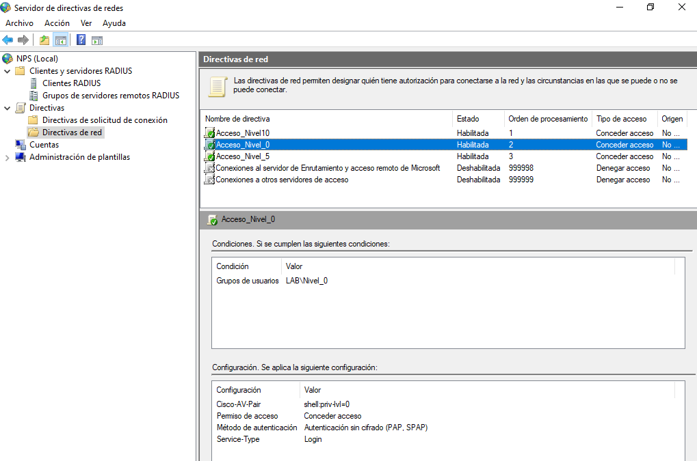

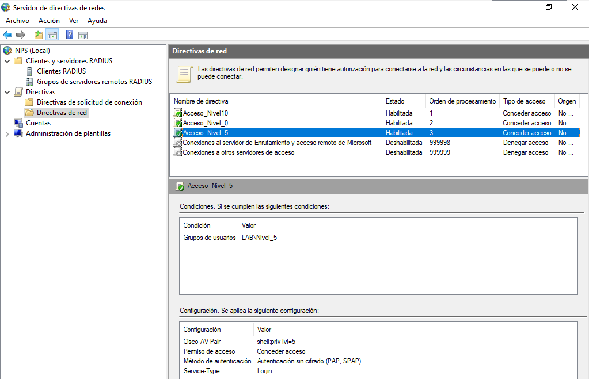

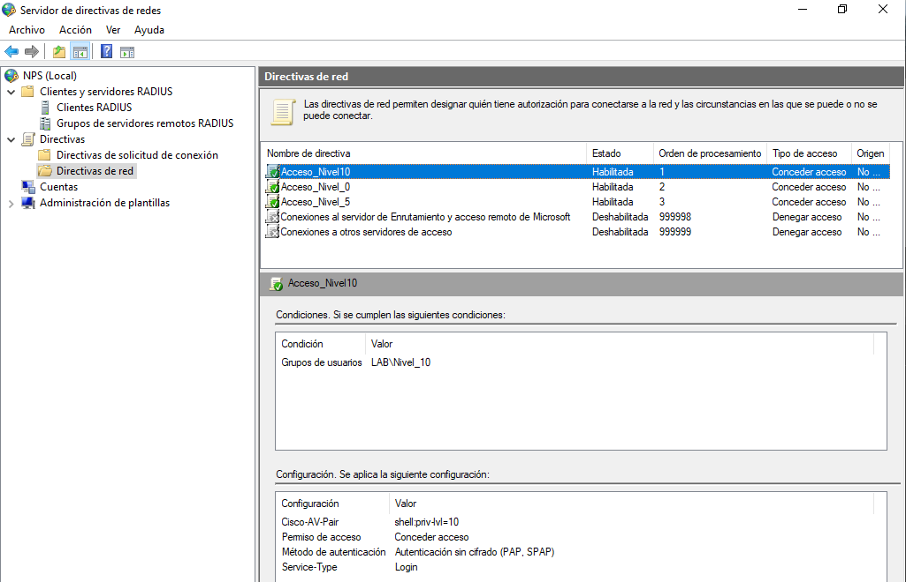

---

## Pruebas

### Acceso por SSH al router (R1)

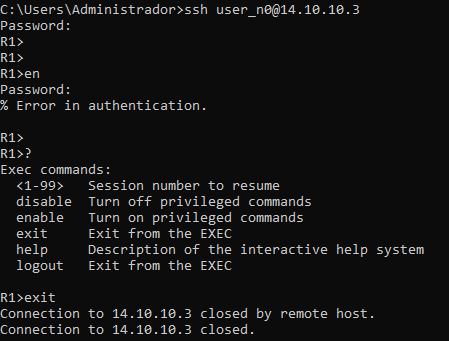

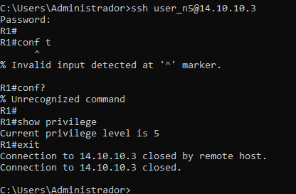

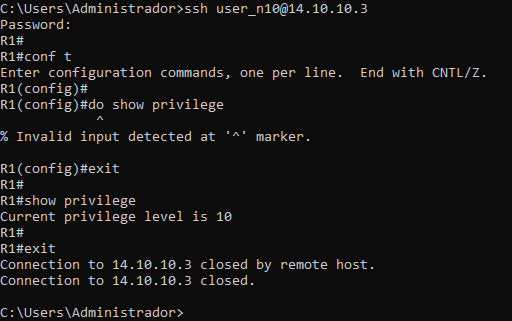

### Acceso por SSH al switch (SW1)

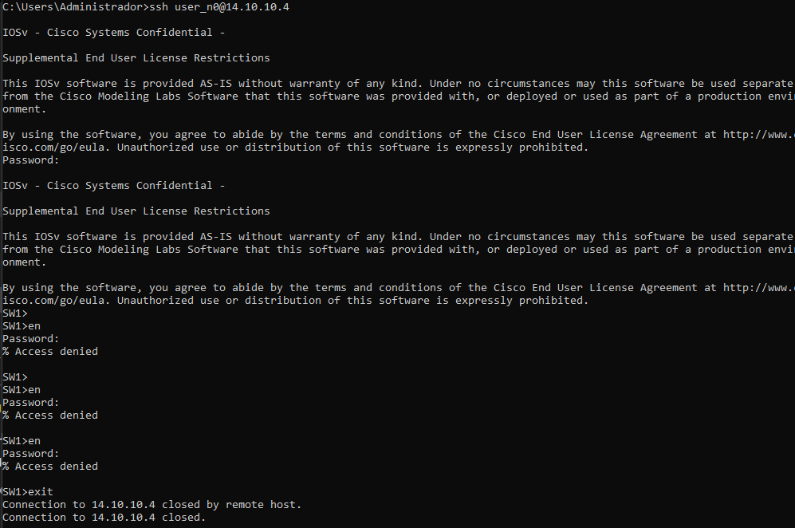

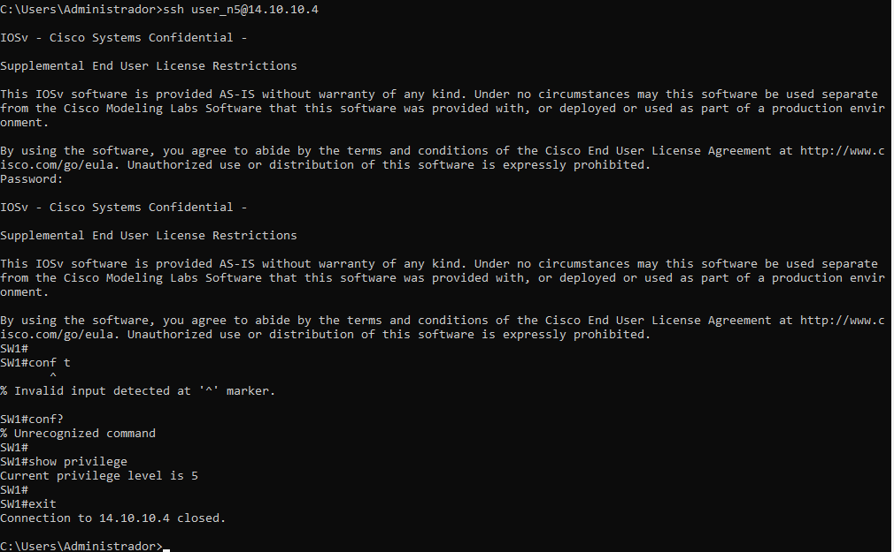

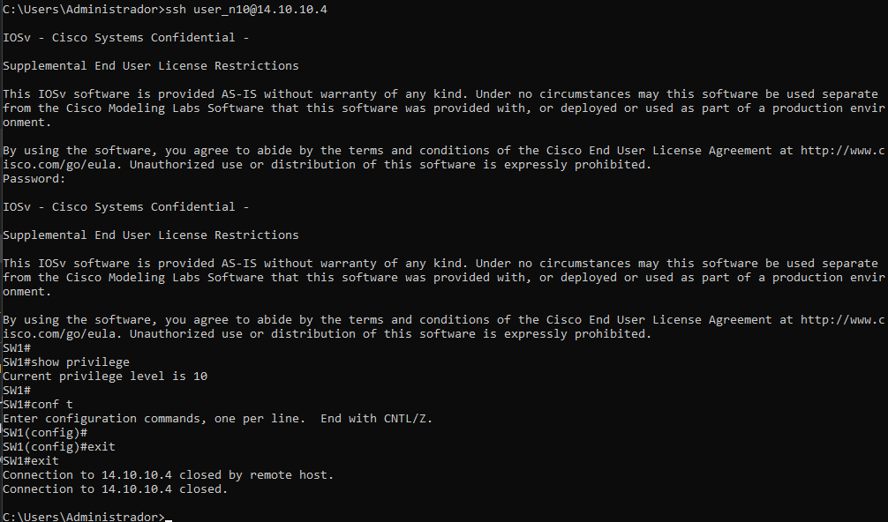

### Logs de autenticación y autorización

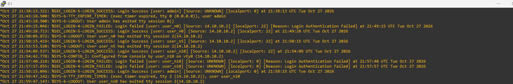

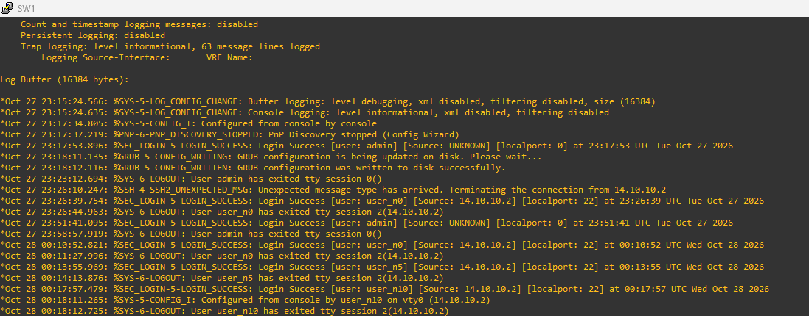

### Eventos en el servidor (NPS)

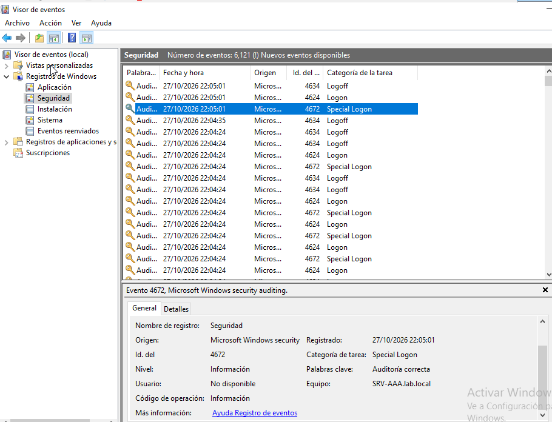
